# appsec-assurance

**An evidence-driven application security audit and hardening skill for [Claude Code](https://claude.com/claude-code).**

appsec-assurance turns Claude Code into a careful application security team. It pairs a
deterministic, dependency-free scanning engine with a structured expert review workflow. The
workflow covers threat modeling, authorization and business-logic review, attack-path chaining,
safe validation and remediation. Every result is backed by evidence, and every gap in coverage is
written down.

> **What it will not do:** declare your application "secure". It reports what was found, how
> confident it is, and what was *not* tested. Absence of findings is not proof of security.

---

## Highlights

- **Five modes:** `quick`, `comprehensive`, `deep`, `remediate` and `continuous` (CI).
- **Stack-aware:** detects languages, frameworks, package managers, data stores, containers,
  Kubernetes, Terraform/CloudFormation, CI systems, cloud providers and mobile targets, then loads
  the matching stack guides.
- **Broad coverage:** 140 built-in rules in 10 packs (secrets, injection, XSS, crypto, auth/session,
  configuration, deserialization, IaC/containers, CI/CD, supply chain and malware indicators), plus
  structural checks for lockfiles, typosquats, git-tracked secrets and dependency install hooks.
- **Uses the tools you already trust:** Semgrep, Gitleaks, OSV-Scanner, Trivy, Bandit, gosec,
  govulncheck, Brakeman, Checkov, Hadolint, zizmor, npm audit, pip-audit and OWASP ZAP (baseline).
  Any tool that emits SARIF plugs in with a single line. Missing tools never break a run; they are
  recorded as coverage gaps along with an install hint.
- **Expert review built in:** 24 checklists with about 370 items mapped to OWASP Top 10, API Top 10
  2023, ASVS 5.0 chapters, MASVS and CWE. There are also 12 stack guides covering sources, sinks
  and framework pitfalls, and 11 methodology references.
- **Safe by design:** read-only by default. A scope file plus explicit approval gate every network
  action. Payloads are benign markers only. Discovered secrets are redacted everywhere and never
  used.
- **Honest scoring:** severity, confidence and status (`confirmed` / `suspected` / `unverified` /
  `missing-control` / …) are kept separate. Includes a CVSS 3.1 calculator. False-positive
  decisions require a written reason.
- **Useful outputs:** a Markdown report for developers and leadership, `findings.json`, SARIF 2.1.0
  for GitHub code scanning, a coverage ledger, an attack-surface inventory and a JSONL audit log.
- **CI-ready:** stable fingerprints that survive line shifts, baseline diffing (new / fixed /
  unchanged), and a gate on *new* findings.
- **Zero dependencies:** Python 3.9+ standard library only. Deterministic output.

## Quick start

```bash
git clone https://github.com/OWNER/appsec-assurance.git
cd appsec-assurance
./install.sh            # installs to ~/.claude/skills/appsec-assurance
```

Then, in any repository, open Claude Code and ask:

> Run a comprehensive security audit of this repository.

Or invoke the skill directly: `/appsec-assurance deep`.

### Other installation options

| Method | Command |
|---|---|
| Per-project (commit it for your team) | `./install.sh --project` → `.claude/skills/appsec-assurance` |
| Symlink for skill development | `./install.sh --link` |
| Claude Code plugin marketplace | `/plugin marketplace add OWNER/appsec-assurance` then `/plugin install appsec-assurance` |
| Manual | copy `skills/appsec-assurance/` to `~/.claude/skills/` |

Check what is available in your environment:

```bash
python3 ~/.claude/skills/appsec-assurance/scripts/appsec.py doctor
```

## How it works

```mermaid
flowchart LR
  A[Detect stack] --> B[Inventory attack surface] --> C[Automated checks<br/>built-in rules + external tools]
  C --> D[Triage with evidence] --> E[Manual review<br/>checklists + stack guides]
  E --> F[Threat model &<br/>attack chaining] --> G[Safe validation<br/>scope-gated] --> H[Report<br/>MD + JSON + SARIF]
  H --> I[Remediate with<br/>regression tests] --> J[Re-scan & diff]
```



1. **The engine** (`scripts/appsec.py scan`) does the exhaustive and repeatable work: stack
   detection, inventory, rules, tools, scoring, de-duplication and the coverage ledger.
2. **Claude** does the work scanners can't. It traces authorization on every route, reviews
   business logic and race conditions, follows source-to-sink data flows, models threats and
   chains weaknesses into attack paths. It records each decision in `.appsec/manual-findings.json`.
3. **The report step** merges both halves into one auditable report. Every closed finding keeps its
   reason, and every gap is listed.

See [docs/architecture.md](docs/architecture.md) for the module map and design principles.

## Modes

| Mode | Use it for | Active testing |
|---|---|---|
| `quick` | PR checks, first look: secrets, dependencies, dangerous sinks, configs | none |
| `comprehensive` *(default)* | Full static and manual review of code, APIs, IaC, CI/CD and dependencies | only if approved and in scope |
| `deep` | Maximum depth: STRIDE threat model, cross-component analysis, attack chaining, safe PoCs | within scope, each PoC approved |
| `remediate` | Fixes and regression tests for existing findings, applied only after approval | local tests only |
| `continuous` | CI: diff against a baseline and fail on new findings | none |

Details: [references/modes.md](skills/appsec-assurance/references/modes.md).

## Safety model

| Activity | Gate |
|---|---|
| Reading the repo, built-in engine, offline tools | none (logged) |
| Tools that download rules or advisory DBs | on by default, `--offline` disables |
| `--osv-api` (sends package names and versions to api.osv.dev) | ask the user first |
| Passive DAST (one GET, header and cookie analysis) | scope file → `scope-check` → user approval → `--approved` |
| Active validation and PoCs (benign markers) | scope lists target and activity, environment is non-production, each PoC approved |
| DoS, brute force, social engineering, malware execution, exfiltration, third-party targets, using found secrets | **never** |

Full rules: [references/rules-of-engagement.md](skills/appsec-assurance/references/rules-of-engagement.md).
Scope template: [templates/scope.template.json](skills/appsec-assurance/templates/scope.template.json).

## Example output

[`examples/sample-assessment/`](examples/sample-assessment/) contains a complete run against the
deliberately vulnerable fixture. It includes analyst triage, a manual finding and a critical attack
path (SSRF → IMDSv1 → AWS credentials). Start with
[report.md](examples/sample-assessment/report.md). Regenerate it with `python3 examples/generate.py`.

An excerpt:

```text
Risk indicator: CRITICAL — Critical risk: at least one confirmed critical issue or critical attack path.

| Severity | critical | high | medium | low | info |
| Open     | 2        | 28   | 20     | 10  | 0    |

### AP-1: Anonymous SSRF to AWS credential theft (critical)
Chain: AUTO-0011 → AUTO-0037 → MAN-001
```

## Using the engine directly

```bash
S=~/.claude/skills/appsec-assurance/scripts/appsec.py
python3 $S scan --mode comprehensive --out .appsec/out          # automated assessment
python3 $S validate .appsec/manual-findings.json                 # check the analyst file
python3 $S report --in .appsec/out --manual .appsec/manual-findings.json
python3 $S cvss "CVSS:3.1/AV:N/AC:L/PR:N/UI:N/S:U/C:H/I:H/A:H"   # 9.8 critical
python3 $S ci --baseline .appsec/baseline.json --fail-on high    # CI gate on new findings
python3 $S scope-check --target http://localhost:3000 --activity dast-passive
```

Exit codes: `0` ok · `1` gate failed · `2` error · `3` denied by scope. Full reference:
[docs/usage.md](docs/usage.md).

## Configuration

Optional `.appsec/config.json` in the target repo (template:
[config.template.json](skills/appsec-assurance/templates/config.template.json)). It controls the
default mode, the fail threshold, path exclusions, enabled rule packs, disabled rules, severity
overrides, custom rule directories, tool selection and timeouts, and network use. Unknown keys are
rejected so typos can't silently weaken a scan.

## CI/CD

Ready-made templates are in [`examples/ci/`](examples/ci/): GitHub Actions (with SARIF upload to
code scanning), GitLab CI, and a pre-commit hook. Commit `.appsec/baseline.json` and review changes
to it in pull requests. A baseline hides existing risk from the gate, so treat it like code.

## Repository layout

```text
.claude-plugin/              plugin + marketplace manifests
skills/appsec-assurance/     ← the installable skill
  SKILL.md                   workflow, modes, rules of engagement
  references/                methodology, scoring, evidence, threat modeling, validation, reporting…
  checklists/                24 domain checklists (stable item IDs)
  stacks/                    12 language/framework guides
  rules/                     built-in rule packs (JSON)
  schemas/                   rule, finding, manual-findings JSON Schemas
  templates/                 config, scope, manual-findings templates
  scripts/appsec.py          engine entry point (stdlib Python)
  scripts/appsec/            engine modules + tool adapters
tests/                       unittest suite + generated vulnerable fixture
examples/                    sample assessment, CI templates, generator
docs/                        architecture, usage, extending
```

## Testing

```bash
python3 -m unittest discover -s tests -t . -v
```

The suite (54 tests) checks the following:

- CVSS against known vectors.
- Every rule against positive and negative samples.
- An end-to-end scan of the vulnerable fixture, which must find 53 expected issue types, produce
  zero false positives on its `safe.py`, leak no secrets in any output, and give byte-identical
  results across runs.
- Manual merge and triage, baseline diffing and the CI gate.
- The scope gate, including production and expiry rules.
- SARIF ingest, the OSV client (mocked), DAST header analysis and supply-chain heuristics.
- Skill structure and documentation link integrity.

CI also scans this repository with the skill itself.

## Limitations

- Built-in rules are pattern-based and do not perform inter-procedural taint analysis. Install
  Semgrep, CodeQL or a language-specific SAST tool for deeper data flow. Claude's manual phase
  also covers this.
- Dependency results cover known advisories only. Reachability is analyzed only by govulncheck (Go).
- DAST is intentionally limited to passive checks plus individually approved, benign validation.
- Mapping findings to a standard is not compliance certification.

## Contributing

Rules, checklists, stack guides and adapters are all data or small plugins. See
[CONTRIBUTING.md](CONTRIBUTING.md) and [docs/extending.md](docs/extending.md). Report
vulnerabilities in this project privately; see [SECURITY.md](SECURITY.md).

## License

[MIT](LICENSE). Use it only on systems you own or are explicitly authorized to assess.
