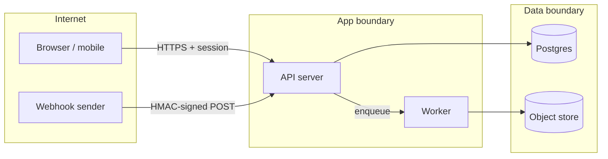

# Threat modeling (deep mode; abbreviated in comprehensive)

Save output to `.appsec/out/threat-model.md`.

## 1. System model
- Purpose, users/roles, assets (data classes, money, credentials, compute).
- Data-flow diagram in Mermaid: external entities, processes, data stores, and
  **trust boundaries** as subgraphs. Derive it from `inventory.json`,
  routes, IaC and CI — not from documentation alone.

## 2. STRIDE per boundary crossing

For each arrow crossing a boundary, list threats and the control that
mitigates each (with file:line evidence) or mark it **unmitigated**:

| Flow | S (spoofing) | T (tampering) | R (repudiation) | I (info disclosure) | D (DoS) | E (elevation) |
|---|---|---|---|---|---|---|

## 3. Abuse cases
Write 5–15 attacker stories tied to business value: "As a free-tier user I
apply the same coupon concurrently to get it N times", "As a tenant admin I
change `tenantId` in the request to read another tenant".

## 4. Attack paths
Chain weaknesses (automated + manual findings) into end-to-end paths with a
goal (e.g. "read all customer PII", "deploy code to production"). Record each
in `attack_paths` of the manual findings file with ordered `steps` (finding
IDs) and a chain severity.

## 5. Ranking and output
Rank threats by likelihood × impact; map top threats to findings, missing
controls (`missing-control` findings) or accepted risks. Note assumptions
(e.g. "the gateway strips X-Forwarded-For") as things to verify.
